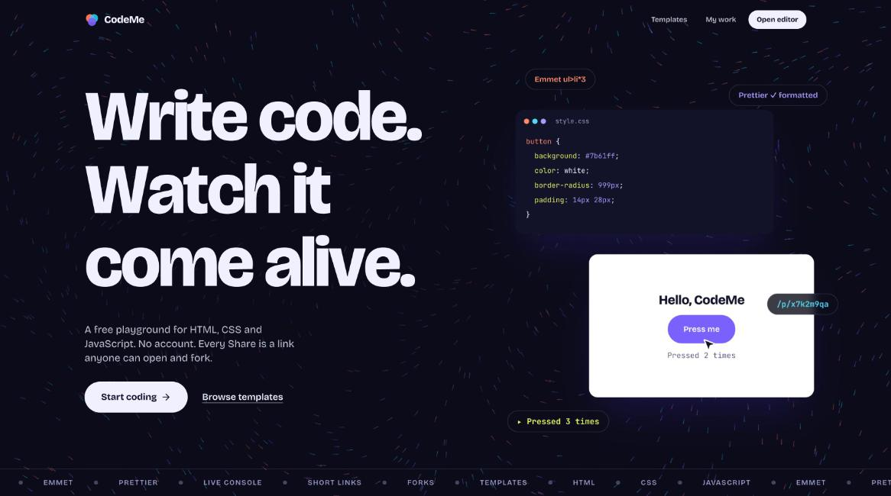
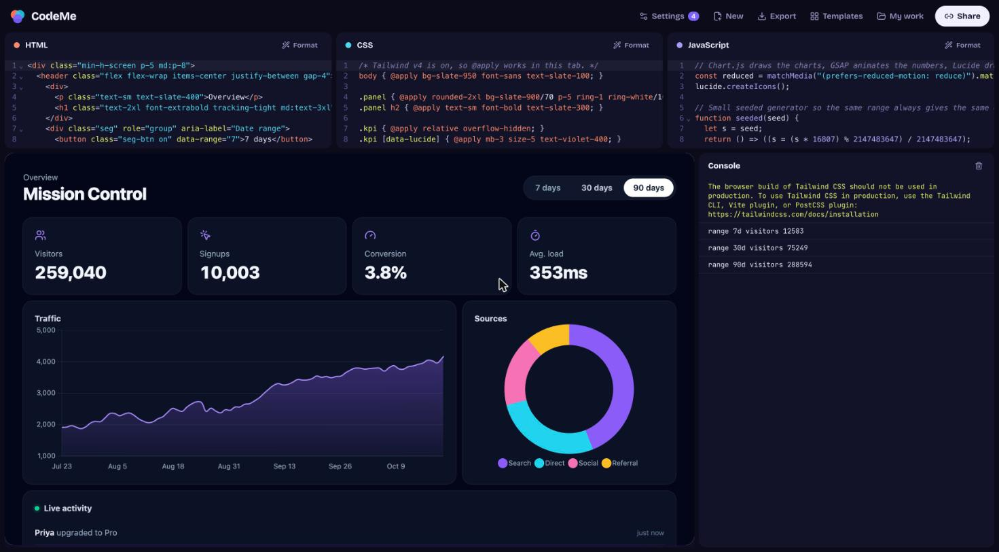
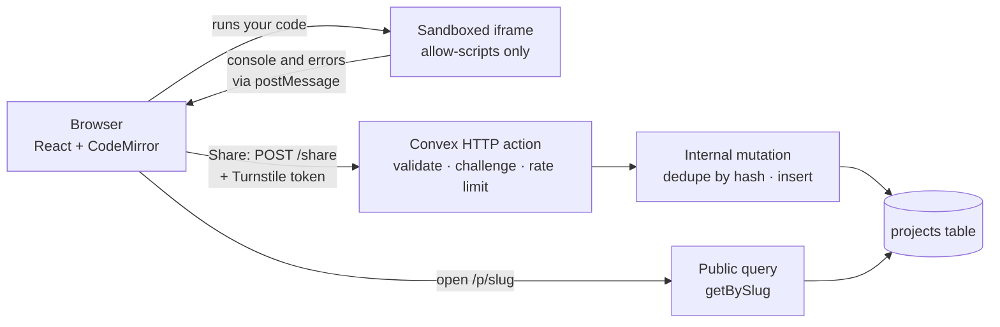

<div align="center">

# CodeMe

**A fast, free playground for HTML, CSS and JavaScript.**
Write code, watch it run, and share a short link anyone can open and fork. No account.

[**Live demo**](https://codeme-play.vercel.app) · [Templates](https://codeme-play.vercel.app/gallery) · [How it works](#architecture) · [Design decisions](#design-decisions)




</div>

## Why CodeMe

Most playgrounds make you pick between **instant and simple** (a blank page that runs) and **powerful but heavy** (a cloud IDE with a build step). CodeMe aims at the first group and adds the parts people actually need when they share a snippet:

- **A link is the whole project.** Press Share and you get a short link. Whoever opens it can read it, run it and change it.
- **Forking is built in.** Open a link, edit, Share again: you get your own copy that remembers where it came from. Nothing is ever overwritten, so nobody can vandalise a link.
- **No account, no setup.** Your work autosaves in the browser until you share it.
- **Honest about its limits.** The sandbox, abuse model and Tailwind caveats are written down in [Design decisions](#design-decisions).

## Features

**Editor**
- Three CodeMirror 6 editors (HTML, CSS, JavaScript) with Emmet, syntax colours matched to each language, and one-click Prettier formatting
- Live preview in a sandboxed iframe with a built-in console
- Console errors point at **your** JavaScript line (`ReferenceError … (JS line 4)`), not the generated document
- Resizable panels, a mobile layout, and reduced-motion support

**Libraries**
- **Tailwind CSS v4** toggle (browser build), including `@apply` in the CSS tab
- **External scripts and styles**: add up to five https links, loaded in order before your code (Chart.js, GSAP, Lucide, and so on)

**Sharing**
- Short links at `/p/<slug>`, stored as immutable snapshots
- Identical code always returns the same link
- Fork lineage shown in the editor header
- Export any project as a small static site (ZIP)

**Starting points**
- Nine ready-made templates, including a multi-library [Mission Control dashboard](#a-template-that-uses-everything)
- A local "My work" list of everything you have shared



### A template that uses everything

**Mission Control** is an analytics dashboard built from Tailwind v4, Chart.js, GSAP and Lucide, all loaded through the playground's own Settings panel. It exists to show that a multi-library page runs with zero setup: open the template, and the framework toggle and external resources are configured for you.

## Quick start

Requires Node 20.19+ (or 22.12+) and npm.

```bash
git clone https://github.com/hardikverma22/Code-Me-with-tailwind-reziable-panels.git
cd Code-Me-with-tailwind-reziable-panels
npm install
npm run dev          # http://localhost:5173
```

The editor, preview, templates and URL-hash sharing work immediately. Short links and forks need the backend:

```bash
npx convex dev       # log in, create a project; writes VITE_CONVEX_URL to .env.local
```

### Scripts

| Command | What it does |
|---|---|
| `npm run dev` | Start the Vite dev server |
| `npm run build` | Type-check, then build for production |
| `npm test` | Run the unit tests (Vitest) |
| `npm run lint` | Lint with ESLint |

### Environment variables

| Variable | Where | Required | Purpose |
|---|---|---|---|
| `VITE_CONVEX_URL` | Vercel / `.env.local` | For short links | Convex deployment URL. The share endpoint is derived from it. Without it, Share falls back to a compressed URL hash. |
| `VITE_TURNSTILE_SITE_KEY` | Vercel / `.env.local` | Optional | Public Cloudflare Turnstile site key. Turns on the bot challenge in the browser. |
| `TURNSTILE_SECRET` | Convex dashboard | Optional | Turnstile secret key. When set, the server requires a valid challenge token to create a share. |
| `ALLOWED_ORIGIN` | Convex dashboard | Optional | Restricts browser access to the share endpoint to your site's origin. |

## Architecture



- **Frontend:** Vite, React 19, TypeScript, Tailwind CSS 4, Zustand, GSAP and Lenis for the landing page.
- **Backend:** Convex. The only way to create a share is the `/share` HTTP action in front of an *internal* mutation; clients cannot write to the database directly.
- **Hosting:** Vercel for the static app, Convex for the data.

```
src/
  pages/        Landing (+ sections), Editor, Gallery, My work
  components/   Editor, panels, preview, header, settings
  fx/           Motion: smooth scroll, cursor, flow field, kinetic text
  lib/          srcDoc builder, share API, templates, export, tests
  store/        Zustand stores (project, console, saved work)
convex/
  http.ts       POST /share: validation, challenge, rate limits
  projects.ts   Internal create mutation, public getBySlug query
  limits.ts     Rate-limit definitions
```

## Design decisions

**The preview sandbox has no `allow-same-origin`.** The iframe uses `sandbox="allow-scripts allow-modals allow-forms"`. Combining `allow-scripts` with `allow-same-origin` lets the embedded page remove its own sandbox, so it is never added ([MDN](https://developer.mozilla.org/en-US/docs/Web/HTML/Reference/Elements/iframe), [OWASP](https://cheatsheetseries.owasp.org/cheatsheets/HTML5_Security_Cheat_Sheet.html)). A unit test fails if it ever is. Popups and top-level navigation are also off, so `window.open` inside a preview does nothing by design.

**Sharing is a snapshot, not a live document.** A share can never be edited by anyone, including its author, so a link cannot be vandalised. Forking is "open, edit, Share again": it creates a new snapshot that records its parent. The tradeoff is that an author cannot update a link in place.

**Convex only stores short links and forks.** Running code never needs a server. Without a backend configured, Share falls back to a compressed URL hash (lz-string), so the app still works.

**Errors point at your line.** The preview injects the line offset of your JavaScript, so an error refers to line 4 of your script, not line 31 of the generated page. A test pins this behaviour.

**Tailwind runs through its browser build.** Tailwind documents this build as development-only. CodeMe uses it so snippets work with no setup, says so in the Settings panel, and the Export download adds a note to use the Tailwind CLI for production.

## Security and abuse model

Anyone can call a public endpoint, so the write path is metered rather than trusted.

| Layer | What it does |
|---|---|
| Private mutation | `create` is internal. The only entry point is `POST /share`. |
| Input validation | Types, size (about 200 KB of code, 400 KB per request), https-only resource links, at most five. |
| Duplicate check | Content is hashed with SHA-256. Identical code returns the existing link and uses no quota. |
| Rate limits | Per IP: 10 new shares a day and a burst of 3. Globally: 1,500 shares an hour as a circuit breaker. Built on `@convex-dev/rate-limiter`, in the same transaction as the insert. |
| Bot challenge | Optional Cloudflare Turnstile, verified server-side. Tokens are single-use. |
| No enumeration | Slugs are eight characters from a 32-letter alphabet (about 10^12 combinations) and nothing lists projects. |

**Not covered:** a large distributed attack from many IPs is bounded by the global cap and Turnstile, not eliminated. Old snapshots are not deleted yet, so a retention job is a sensible next step.

## Testing

Unit tests cover the sandbox flags, error-line mapping, Tailwind injection, the share-link codec, and template validity.

```bash
npm test
```

The abuse limits were also checked against a deployed endpoint: bad input, oversized bodies, bursts, duplicate shares and token replay.

## Roadmap

- Retention policy for old snapshots
- Production Convex deployment with a locked-down origin
- Real-time collaboration in a single room (Yjs and `y-codemirror.next`)
- Social preview images for shared links
- Accounts, only if a feature needs them

## Known limits

- Tailwind and external libraries load from a CDN, so they need an internet connection.
- No npm packages or bundler: the preview is a plain browser document by design.
- "My work" is stored on the device until accounts exist.

## License

[MIT](LICENSE) © 2026 hardikverma22

## Acknowledgements

Built with [CodeMirror](https://codemirror.net), [Convex](https://convex.dev), [GSAP](https://gsap.com), [Prettier](https://prettier.io), [Emmet](https://emmet.io), [Tailwind CSS](https://tailwindcss.com) and [Lucide](https://lucide.dev).
